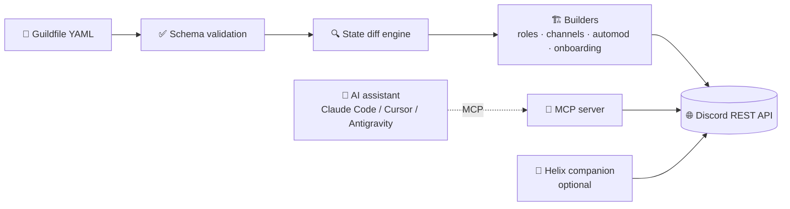

<div align="center">


<a href="https://github.com/Akira-official/guildfile">
  
</a>

<br/>

[](LICENSE)
[](https://python.org)
[](https://discordpy.readthedocs.io)
[](docker/)
[](#-roadmap)
[](CONTRIBUTING.md)

<br/>

**[⚡ Quickstart](#-quickstart)** · **[📜 Blueprint](#-the-guildfile)** · **[🧩 Features](#-features)** · **[🔌 MCP](#-mcp-control-your-server-from-your-ai-assistant)** · **[🤖 Helix](#-optional-helix-ai-companion)** · **[🐳 Docker](#-docker)** · **[❓ FAQ](#-faq)**

</div>

---

## 🎬 See it in action

<div align="center">

<!-- Record a 15s terminal GIF (guild doctor -> guild diff -> guild apply) and save it as assets/demo.gif -->


</div>

---

## 💥 Why this exists

Setting up a serious Discord server by hand means **15-20 hours** of clicking: 25+ roles, permission overrides on every category, AutoMod rules, onboarding questions, ticket channels. One wrong toggle and a staff channel is public.

**guildfile** treats your server like infrastructure:

- 📄 **One YAML file** describes roles, categories, channels, permissions, AutoMod and onboarding.
- 🔁 **Idempotent**: `guild apply` only creates or updates what changed. Existing messages stay untouched.
- 🔍 **Diff before you deploy**: `guild diff` shows exactly what will change.
- 🧪 **Reusable templates**: clone a ready blueprint, tweak, apply.

> Think **Terraform / Dockerfile, but for Discord.**

---

## ⚡ Quickstart

```bash
# 1. Install
git clone https://github.com/Akira-official/guildfile.git
cd guildfile
python -m venv .venv && source .venv/bin/activate   # Windows: .venv\Scripts\Activate.ps1
pip install -e .

# 2. Configure
cp .env.example .env     # add your bot token + guild ID

# 3. Check, preview, deploy
guild doctor
guild diff  --blueprint templates/ai-agent-community.yaml
guild apply --blueprint templates/ai-agent-community.yaml
```

**`.env` example (use your own values, never commit this file):**

```env
DISCORD_TOKEN=YOUR_DISCORD_BOT_TOKEN
DISCORD_GUILD_ID=000000000000000000
GROQ_API_KEY=YOUR_GROQ_API_KEY      # only needed for the optional Helix agent
```

<details>
<summary><b>🔑 Discord bot setup (2 minutes)</b></summary>

1. Create an app in the [Discord Developer Portal](https://discord.com/developers/applications).
2. Under **Bot**, enable **Server Members Intent** (and **Message Content Intent** if you run the Helix agent).
3. Invite the bot to your server with the permissions your blueprint needs (Administrator is the easiest for first setup).

</details>

---

## 📜 The Guildfile

Your whole server in one readable file:

```yaml
metadata:
  name: "My Community"
  version: "1.0.0"

roles:
  - name: "Founder"
    color: "#E74C3C"
    hoist: true
    permissions:
      administrator: true

  - name: "Moderator"
    color: "#3498DB"
    hoist: true
    permissions:
      manage_messages: true
      kick_members: true

categories:
  - name: "📌 ┆ START HERE"
    channels:
      - { name: "👋・welcome", type: text, read_only: true }
      - { name: "📜・rules",   type: text, read_only: true }

  - name: "💬 ┆ COMMUNITY"
    channels:
      - { name: "💬・general", type: text, slowmode: 2 }
      - { name: "✨・showcase", type: forum }
      - { name: "🔊・lounge",   type: voice }

  - name: "🔒 ┆ STAFF"
    private: true
    allowed_roles: ["Founder", "Moderator"]
    channels:
      - { name: "💼・staff-chat", type: text }
```

📖 Full reference: [`docs/blueprint-schema.md`](docs/blueprint-schema.md)

---

## 🧩 Features

<table>
<tr>
<td width="50%" valign="top">

### 🏗️ Declarative provisioning
Roles, colors, permission overrides, categories, channels, forum tags and webhooks from YAML or JSON, validated with Pydantic.

</td>
<td width="50%" valign="top">

### 🔁 Idempotent sync
State diff between your blueprint and the live server. Create what is missing, update what changed, leave the rest alone.

</td>
</tr>
<tr>
<td valign="top">

### 🛡️ Secure defaults
Hardened `@everyone` baseline, private staff categories, and AutoMod rules for invite links, token leaks, mention spam and scam patterns.

</td>
<td valign="top">

### 🎟️ Onboarding & tickets
Onboarding questions and default channels, plus a ticket setup with private channels, transcript archive and staff roles.

</td>
</tr>
<tr>
<td valign="top">

### 🩺 `guild doctor`
Health check for token, intents, guild access, rate limits and database integrity before you deploy.

</td>
<td valign="top">

### 🔌 MCP server
Let Claude Code, Cursor or Antigravity inspect and manage your server in plain English.

</td>
</tr>
</table>

> ⚠️ **Heads up:** a few Discord features (parts of Onboarding and some AutoMod options) are only partially configurable through the public API. Each template documents what is automated and what needs a manual click.

---

## 🏛️ Architecture



---

## 🔌 MCP: control your server from your AI assistant

Expose your server to any MCP-compatible assistant and manage it in plain English:

```text
"Lock #general for 30 minutes."
"Audit role permissions and report any privilege leaks."
"Post a release announcement for v2.0 in #announcements."
```

📖 Setup guide: [`docs/mcp-integration.md`](docs/mcp-integration.md)

---

## 🗂️ Templates

| Template | Best for | Highlights |
| :-- | :-- | :-- |
| 🤖 `ai-agent-community` | AI and builder communities | Showcase forum, support tickets, staff ops |
| 👨‍💻 `developer-dao` | Open-source teams | GitHub webhook channels, bounty board, dev hubs |
| 🎮 `gaming-clan` | Clans and guilds | Voice rooms, scrims, clip showcase |
| 🎨 `creator-studio` | Creators | Tier perks, fan lounge, announcements |
| 🌱 `minimal-community` | Quick start | Small, clean, safe baseline |

---

## 🤖 Optional: Helix AI Companion

Want a community bot that does not sound like a robot? The optional **Helix** module adds:

| | |
| :-- | :-- |
| 💬 **Burst typing** | Replies split into 2-3 short messages with natural delays |
| 🧠 **Memory** | SQLite social graph: nicknames, closeness, inside jokes (stored locally) |
| 🎭 **Moods** | `chill`, `annoyed`, `petty`, `boss`, `late_night_chaotic` |
| 🗣️ **Code-switching** | English, Hinglish and slang |
| 🖼️ **Vision** | Reacts to screenshots and memes via a multimodal model |
| 🟢 **Presence cycler** | Rotating Playing / Listening / Watching status |

```text
[8:15 AM] dev_user: yo helix, you awake?
[8:15 AM] Helix: yeah what's up
[8:15 AM] Helix: spit it out, i'm all ears
```

> 🏷️ Helix is clearly a **bot**: it carries Discord's BOT tag and does not pretend to be a person. Please follow the [Discord Developer Terms](https://discord.com/developers/docs/policies-and-agreements/developer-terms-of-service) when you deploy it.

LLM provider: **Groq by default**, with OpenAI-compatible endpoints and local Ollama supported.

```bash
guild agent
```

---

## 🐳 Docker

Run 24/7 on any VPS, Railway or a Raspberry Pi:

```bash
cd docker
docker compose up -d --build
```

SQLite memory and logs are mounted to the host, so backups are a simple file copy.

---

## 🗺️ Roadmap

- [ ] Blueprint schema + Pydantic validation
- [ ] `guild diff` and idempotent `guild apply`
- [ ] Export an existing server to a Guildfile (`guild export`)
- [ ] MCP server tools (audit, lock, announce)
- [ ] `guild doctor` full diagnostics
- [ ] Multi-guild memory for Helix
- [ ] Docker one-click deploy
- [ ] More community templates

Have an idea? [Open an issue](../../issues/new) 💡

---

## ❓ FAQ

<details>
<summary><b>Does <code>guild apply</code> delete my messages?</b></summary>
<br/>
No. Apply is idempotent: it creates missing items and updates changed permissions. Message history is never touched.
</details>

<details>
<summary><b>I get <code>PrivilegedIntentsRequired</code></b></summary>
<br/>
Enable the required intents (Server Members, and Message Content for Helix) on your bot's page in the Discord Developer Portal.
</details>

<details>
<summary><b>Can I use OpenAI, Claude or Ollama instead of Groq?</b></summary>
<br/>
Yes. The agent uses a provider abstraction, so you can switch via environment variables.
</details>

<details>
<summary><b>Is my data sent anywhere?</b></summary>
<br/>
Conversation memory is stored locally in SQLite. Only the text you send to your chosen LLM provider leaves your machine.
</details>

---

## 🔒 Security

- Never commit `.env` or tokens. Use the provided `.env.example`.
- Run with the minimum Discord permissions and intents your blueprint needs.
- Found a vulnerability? See [`SECURITY.md`](SECURITY.md).

---

## 🤝 Contributing

1. Fork the repo
2. `git checkout -b feat/amazing-feature`
3. `git commit -m "feat: add amazing feature"`
4. `git push origin feat/amazing-feature`
5. Open a Pull Request

Read the [Contributing Guide](CONTRIBUTING.md) first.

---

## ⭐ Star History

<div align="center">

<a href="https://star-history.com/#Akira-official/guildfile&Date">
  
</a>

### If this saved you hours, drop a ⭐. It helps a lot.

📄 Released under the [MIT License](LICENSE) · Built by [Akira](https://github.com/Akira-official) & [Vyoma Group](https://vyomagroup.online)


</div>
